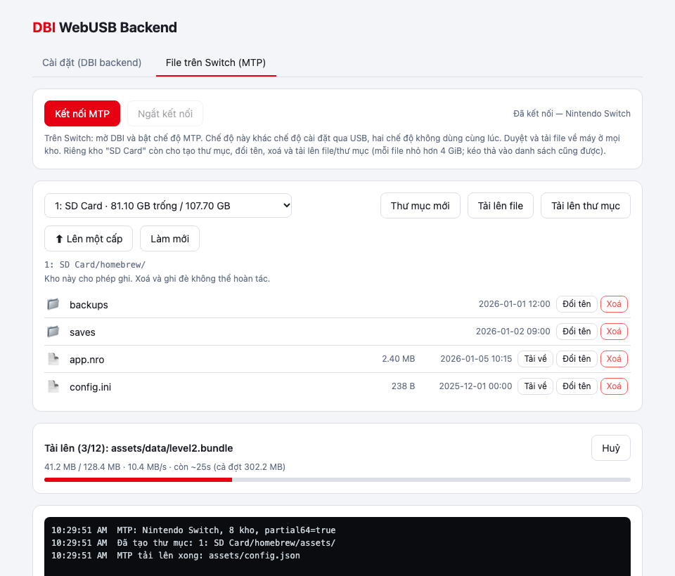

# DBI WebUSB

Công cụ web chạy hoàn toàn trên trình duyệt để làm việc với Nintendo Switch qua cáp USB, dựa trên [DBI](https://github.com/rashevskyv/dbi). Không cần cài Python hay driver, chỉ cần Chrome hoặc Edge.

Có hai chế độ, mỗi chế độ một tab:

1. **Cài đặt (DBI backend):** thay thế `dbibackend` (Python), copy file `.nsp` / `.xci` từ máy tính sang Switch.
2. **File trên Switch (MTP):** duyệt thẻ SD và bộ nhớ của Switch, tải file về máy, tạo thư mục, đổi tên, xoá, tải lên file và thư mục.




*Ảnh minh hoạ với dữ liệu mẫu.*

## Tab Cài đặt (DBI backend)

- Giao tiếp USB bằng **WebUSB** (VID `0x057e`, PID `0x3000`), tự tìm endpoint Bulk IN/OUT.
- **Streaming từng chunk** bằng `file.slice().arrayBuffer()`, không nạp cả file vào RAM nên file hàng chục GB vẫn ổn.
- Kéo thả file hoặc thư mục `.nsp .nsz .xci .xcz`.
- Hiển thị **tên game, loại (Base / Update / DLC), phiên bản, Title ID** suy ra từ tên file. App không giải mã file và không cần khoá.
- Thanh tiến trình, tốc độ MB/s, thời gian còn lại (ETA) từng file và cả hàng đợi, khung log.
- Báo trạng thái **Hoàn tất**, kèm âm báo và thông báo trình duyệt.
- **Nhớ danh sách file/thư mục** giữa các lần mở trang (bấm khôi phục để cấp lại quyền đọc).
- **Tự kết nối lại** khi cắm lại Switch, và **chống ngủ máy** khi đang truyền.
- Báo lỗi rõ ràng khi rút cáp giữa chừng hoặc khi thiết bị bị ứng dụng khác chiếm.

## Tab File trên Switch (MTP)

Dùng chế độ MTP của DBI (VID `0x057e`, PID `0x201d`).

- Chọn kho (SD Card, NAND, Saves, Album...), xem dung lượng trống, duyệt thư mục, xem kích thước và ngày sửa.
- **Tải file về máy** theo từng khối bằng `GetPartialObject64`, ghi thẳng xuống đĩa, không nạp cả file vào RAM.
- Riêng kho **SD Card** còn cho phép ghi:
  - Tạo thư mục, đổi tên, xoá (có hộp xác nhận, thư mục hoặc thư mục hệ thống/CFW phải gõ lại tên để xác nhận).
  - **Tải lên file và cả thư mục** (kéo thả hoặc nút chọn): app quét nguồn, hiện tóm tắt để xác nhận, tạo lại cấu trúc thư mục và tải từng file, kiểm tra kích thước sau khi ghi.
  - Không bao giờ ghi đè: thư mục có sẵn được gộp vào, file trùng tên bị bỏ qua. File rác của máy tính (`.DS_Store`, `Thumbs.db`, `._*`...) tự động bị bỏ qua.
  - **Mỗi file phải nhỏ hơn 4 GiB** (giới hạn của FAT32 và của gói MTP 32-bit). File lớn hơn bị từ chối.
- Các kho khác (NAND, Saves, các kho "install", Album) chỉ đọc và tải về.

## Cách dùng

Mở bản chạy trực tuyến: https://dbicopy.web.app, hoặc chạy cục bộ. WebUSB cần secure context nên phải qua `localhost`:

```bash
cd public && python3 -m http.server 8000
```

Rồi mở `http://localhost:8000` bằng Chrome hoặc Edge.

**Cài đặt qua USB:** trên Switch mở DBI và chọn chế độ cài từ USB, cắm cáp, thêm file hoặc thư mục, bấm **Kết nối Switch** rồi chọn thiết bị trên Switch.

**Duyệt và quản lý file:** trên Switch bật chế độ MTP của DBI (khác chế độ cài đặt, hai chế độ không dùng cùng lúc), vào tab **File trên Switch (MTP)** và bấm **Kết nối MTP**.

Dự án chỉ gồm một file [`public/index.html`](public/index.html), không có bước build.

## Lưu ý

- Dùng cáp USB có dây dữ liệu, cắm trực tiếp vào cổng USB-C của Switch (không qua dock hay hub). Cáp chỉ sạc là nguyên nhân thường gặp khi không thấy thiết bị.
- Tốc độ thực tế thường quanh 10–20 MB/s và chủ yếu do Switch ghi dữ liệu vào bộ nhớ đích quyết định, không phải do cáp hay trình duyệt.
- Trên macOS, nếu không chiếm được thiết bị, hãy đóng các ứng dụng khác đang dùng USB Switch (dbibackend, Tinfoil...) rồi cắm lại cáp.
- Windows cần driver WinUSB cho thiết bị (ví dụ cài bằng Zadig), Linux cần quy tắc udev. Tab MTP được thử trên macOS.
- Xoá file là vĩnh viễn, không có thùng rác. Hãy cẩn thận với các thư mục hệ thống như `atmosphere`, `emuMMC`, `Nintendo`.
- Chrome không giữ quyền đọc file sau khi tải lại trang. Dùng nút khôi phục để cấp lại.
- Nhớ danh sách, chọn thư mục và lưu file dùng File System Access API, nên chỉ hoạt động trên trình duyệt nhân Chromium (Chrome, Edge).

## Triển khai

Triển khai bằng Firebase Hosting, thư mục phục vụ là `public/` (cấu hình trong `firebase.json`):

```bash
firebase deploy --only hosting
```

## Miễn trừ

Dự án không liên kết với Nintendo hay DBI. Chỉ dùng với dữ liệu mà bạn có quyền sử dụng hợp pháp, ví dụ bản sao lưu từ chính máy và game của bạn.
