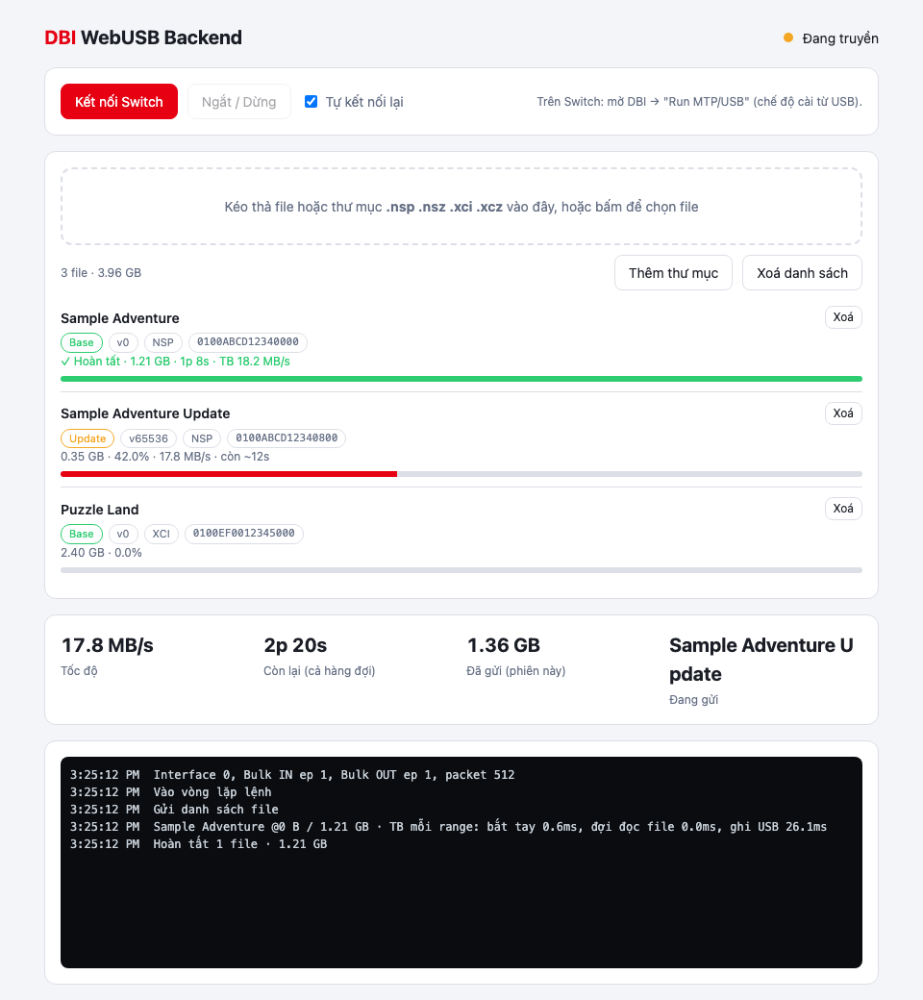

# DBI WebUSB

Công cụ web chạy hoàn toàn trên trình duyệt để copy file `.nsp` / `.xci` từ máy tính sang Nintendo Switch qua cáp USB, thay thế `dbibackend` (Python) của [DBI](https://github.com/rashevskyv/dbi). Không cần cài Python hay driver, chỉ cần Chrome hoặc Edge.



*Ảnh minh hoạ với dữ liệu mẫu.*

## Tính năng

- Giao tiếp USB bằng **WebUSB** (VID `0x057e`, PID `0x3000`), tự tìm endpoint Bulk IN/OUT.
- **Streaming từng chunk** bằng `file.slice().arrayBuffer()`, không nạp cả file vào RAM nên file hàng chục GB vẫn ổn.
- Kéo thả file hoặc thư mục `.nsp .nsz .xci .xcz`.
- Hiển thị **tên game, loại (Base / Update / DLC), phiên bản, Title ID** suy ra từ tên file. App không giải mã file và không cần khoá.
- Thanh tiến trình, tốc độ MB/s, thời gian còn lại (ETA) từng file và cả hàng đợi, khung log.
- Báo trạng thái **Hoàn tất**, kèm âm báo và thông báo trình duyệt.
- **Nhớ danh sách file/thư mục** giữa các lần mở trang (bấm khôi phục để cấp lại quyền đọc).
- **Tự kết nối lại** khi cắm lại Switch, và **chống ngủ máy** khi đang truyền.
- Báo lỗi rõ ràng khi rút cáp giữa chừng hoặc khi thiết bị bị ứng dụng khác chiếm.

## Cách dùng

WebUSB cần secure context, nên chạy qua `localhost`:

```bash
python3 -m http.server 8000
```

1. Mở `http://localhost:8000` bằng Chrome hoặc Edge.
2. Trên Switch, mở DBI và chọn chế độ cài từ USB, rồi cắm cáp.
3. Thêm file hoặc thư mục, bấm **Kết nối Switch** và chọn thiết bị.
4. Trên Switch, chọn file cần cài.

Dự án chỉ gồm một file [`index.html`](index.html), không có bước build.

## Lưu ý

- Tốc độ thực tế thường quanh 10–20 MB/s và chủ yếu do Switch ghi dữ liệu vào bộ nhớ đích quyết định, không phải do cáp hay trình duyệt.
- Trên macOS, nếu không chiếm được thiết bị, hãy đóng các ứng dụng khác đang dùng USB Switch (dbibackend, Tinfoil...) rồi cắm lại cáp.
- Chrome không giữ quyền đọc file sau khi tải lại trang. Dùng nút khôi phục để cấp lại.
- Nhớ danh sách và chọn thư mục dùng File System Access API, nên chỉ hoạt động trên trình duyệt nhân Chromium.

## Miễn trừ

Dự án không liên kết với Nintendo hay DBI. Chỉ dùng với dữ liệu mà bạn có quyền sử dụng hợp pháp, ví dụ bản sao lưu từ chính máy và game của bạn.
